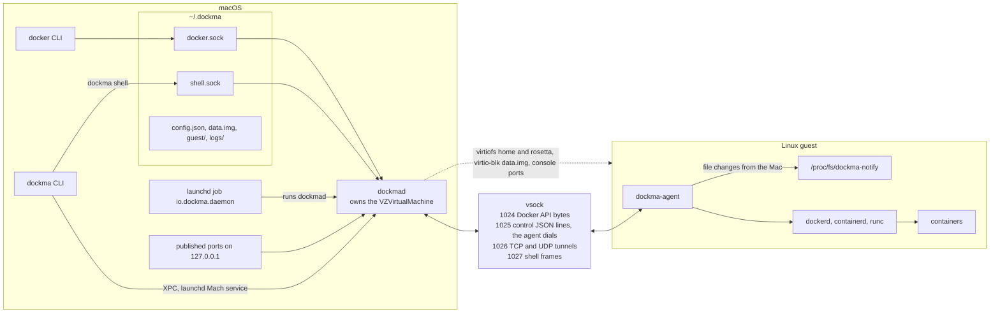
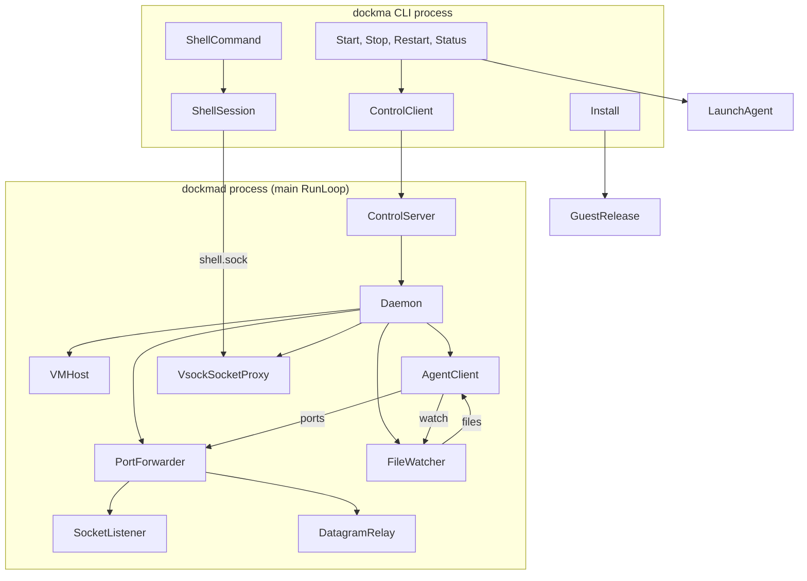
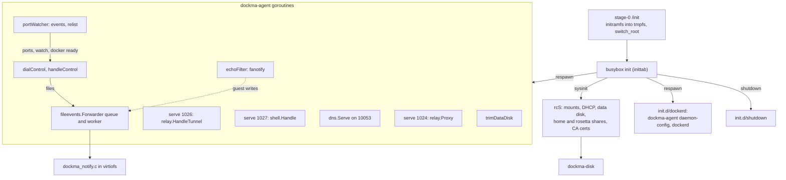
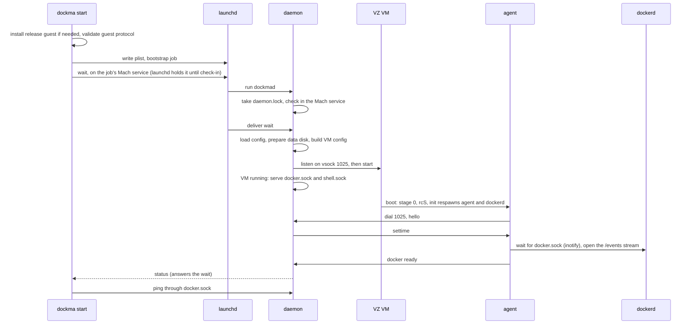
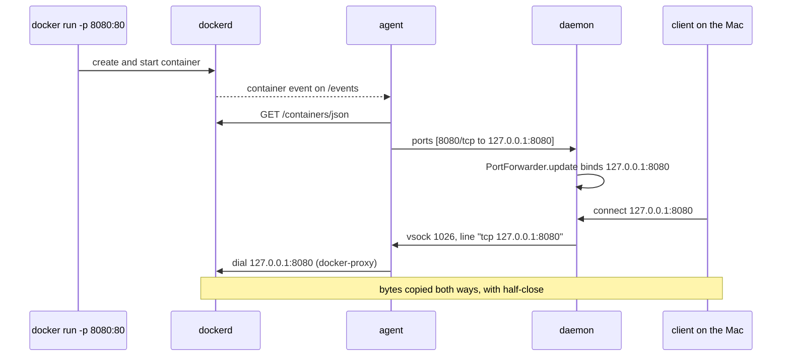
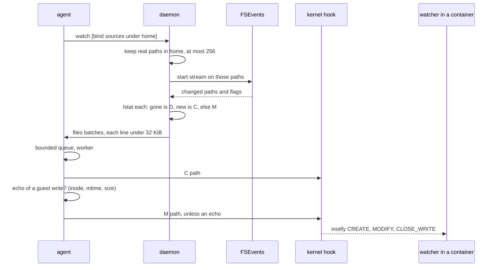
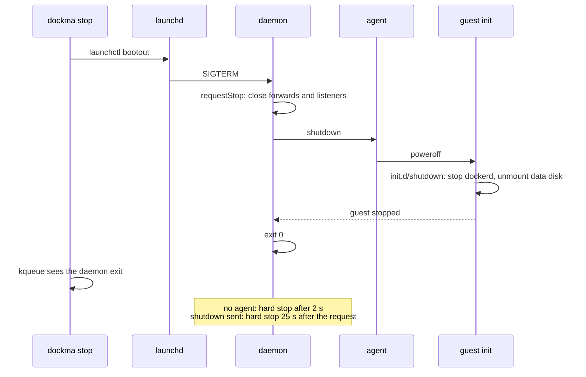
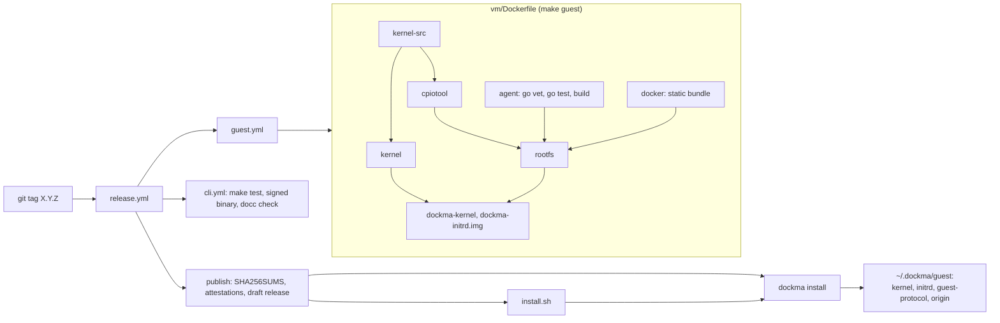

# Architecture

How dockma's parts fit together, for people maintaining it. Each diagram is followed by a table that links every step to the code that does it. The links name a symbol, never a line; `scripts/check-doc-refs.py` fails CI when a linked file or symbol disappears. It can't tell when a diagram stops matching what the code does, so update this page together with any change to a flow it shows.

Related pages:
- [CLAUDE.md](../CLAUDE.md): the host–guest protocol table, the file-by-file source map, and the project's rules and gotchas.
- [shell-protocol.md](shell-protocol.md): the `dockma shell` frames.
- [debugging.md](debugging.md): stepping through these flows with a debugger, layer by layer.
- [README.md](../README.md): what users see.

## 1. System overview

| Part | Code | What it is |
|---|---|---|
| dockma CLI | [`Dockma`](../Sources/DockmaCLI/Dockma.swift) | Every subcommand; it talks to the daemon only through its XPC service and launchd. |
| launchd job | [`LaunchAgent.plist`](../Sources/DockmaCore/Daemon/LaunchAgent.swift) | Runs `dockmad` and declares its Mach service; `KeepAlive.SuccessfulExit=false` restarts it only after a non-zero exit. |
| daemon | [`Daemon`](../Sources/DockmaCore/Daemon/Daemon.swift) | One process per state directory; owns the VM and every forward. |
| vsock ports | [`VMConfigurationBuilder.Port`](../Sources/DockmaCore/VM/VMConfigurationBuilder.swift) | 1024–1027, duplicated as constants in [`main`](../vm/agent/main.go). Messages: CLAUDE.md, "Host–guest protocol". |
| VM devices | [`VMConfigurationBuilder.build`](../Sources/DockmaCore/VM/VMConfigurationBuilder.swift) | CPUs, memory, disks, virtiofs shares, vsock, console ports, network. |
| state directory | [`Paths`](../Sources/DockmaCore/Settings/Paths.swift) | Every file under `~/.dockma` (or `DOCKMA_HOME`). |
| agent | [`main`](../vm/agent/main.go) | One static Go binary, respawned by busybox init. |
| kernel hook | [`dn_apply`](../vm/kernel/dockma_notify.c) | Built into virtiofs; turns `M\|C\|D <path>` into guest inotify events. |

## 2. Host components

| Component | Code | Role |
|---|---|---|
| `start` | [`Start.run`](../Sources/DockmaCLI/Dockma.swift) | Installs a release guest if needed, loads the job, waits for Docker. |
| `stop` | [`Stop.run`](../Sources/DockmaCLI/Dockma.swift) | `launchctl bootout`, then waits for the daemon to exit. |
| daemon entry | [`DaemonCommand.run`](../Sources/DockmaCLI/Dockma.swift) | Creates the `Daemon` and runs the main RunLoop, not `dispatchMain()` (see CLAUDE.md). |
| control client | [`ControlClient.waitUntilReady`](../Sources/DockmaCore/Daemon/ControlProtocol.swift) | One JSON request, one reply, in XPC messages; `wait` is answered once Docker is ready. Checks the job's pid before a lookup, which would make launchd start an exited job. |
| control server | [`ControlServer.listen`](../Sources/DockmaCore/Daemon/ControlProtocol.swift) | Checks in the Mach service, admits only peers signed as the CLI ([`CodeSigning`](../Sources/DockmaCore/VM/Entitlements.swift)), and hands requests to [`Daemon.handle`](../Sources/DockmaCore/Daemon/Daemon.swift). |
| VM wrapper | [`VMHost.start`](../Sources/DockmaCore/VM/VMHost.swift) | Owns `VZVirtualMachine`; [`VMHost.listen`](../Sources/DockmaCore/VM/VMHost.swift) and [`VMHost.connect`](../Sources/DockmaCore/VM/VMHost.swift) for vsock. |
| agent link | [`AgentClient.accept`](../Sources/DockmaCore/Agent/AgentClient.swift) | Takes the agent's connection on 1025 and dispatches its messages in [`AgentClient.handle`](../Sources/DockmaCore/Agent/AgentClient.swift). |
| port forwarding | [`PortForwarder.update`](../Sources/DockmaCore/Forwarding/PortForwarder.swift) | Turns the agent's port set into listeners and relays. |
| Docker and shell sockets | [`VsockSocketProxy.listen`](../Sources/DockmaCore/Forwarding/VsockSocketProxy.swift) | Unix socket → fresh vsock connection → [`SocketCopier.pipe`](../Sources/DockmaCore/Forwarding/SocketCopier.swift). |
| UDP | [`DatagramRelay`](../Sources/DockmaCore/Forwarding/DatagramRelay.swift) | One vsock flow per UDP client, framed by [`DatagramFrame`](../Sources/DockmaCore/Forwarding/DatagramRelay.swift). |
| file events | [`FileWatcher.watch`](../Sources/DockmaCore/Agent/FileWatcher.swift) | FSEvents on the bind mounts the agent names. |
| launchd | [`LaunchAgent.install`](../Sources/DockmaCore/Daemon/LaunchAgent.swift) | Writes the plist and bootstraps the job. |
| guest install | [`GuestRelease.install`](../Sources/DockmaCore/VM/GuestRelease.swift) | Downloads, verifies and swaps in a release guest. |
| shell client | [`ShellSession.run`](../Sources/DockmaCore/Shell/ShellSession.swift) | Raw TTY, signals and stdin flow control over `shell.sock`. |

## 3. Guest components

| Component | Code | Role |
|---|---|---|
| stage 0 | [`init`](../vm/rootfs/init) | Moves the initramfs into a tmpfs, because runc can't `pivot_root` out of rootfs. |
| init table | [`inittab`](../vm/rootfs/etc/inittab) | `rcS` once; the agent and dockerd respawned; `shutdown` before poweroff. |
| boot | [`cmdline_path`](../vm/rootfs/etc/init.d/rcS) | Decodes `dockma.home=` and `dockma.state=` from the cmdline built by [`KernelCmdline.commandLine`](../Sources/DockmaCore/VM/KernelCmdline.swift). |
| data disk | [`dockma-disk`](../vm/rootfs/usr/libexec/dockma-disk) | Formats only a blank disk; checks and grows an existing one. |
| network | [`default.script`](../vm/rootfs/usr/share/udhcpc/default.script) | DHCP lease, `resolv.conf`, the nft redirect of port 53 to the agent. |
| dockerd | [`dockerd`](../vm/rootfs/etc/init.d/dockerd) | Generates and validates the config with [`daemonconfig.Run`](../vm/agent/internal/daemonconfig/daemonconfig.go), then execs dockerd. |
| Docker proxy | [`relay.Proxy`](../vm/agent/internal/relay/relay.go) | Served by [`serve`](../vm/agent/serve.go), which admits only the host ([`isHostPeer`](../vm/agent/serve.go)). |
| tunnels | [`relay.HandleTunnel`](../vm/agent/internal/relay/tunnel.go) | Reads `tcp\|udp <host:port>`; UDP goes to [`relayUDP`](../vm/agent/internal/relay/udp.go). |
| shell | [`shell.Handle`](../vm/agent/internal/shell/shell.go) | Sessions on a pty or pipes. |
| control | [`handleControl`](../vm/agent/control.go) | Sends `hello`, `docker`, `ports`, `watch`; applies `settime`, `files`, `shutdown`. Redialed by [`dialControl`](../vm/agent/control.go). |
| container watcher | [`portWatcher.relist`](../vm/agent/portwatcher.go) | Docker events → [`publishedPorts`](../vm/agent/ports.go) and [`watchedPaths`](../vm/agent/ports.go). |
| DNS | [`dns.Serve`](../vm/agent/internal/dns/dns.go) | `host.docker.internal`, relay to the lease's servers. |
| file events | [`Forwarder.Enqueue`](../vm/agent/internal/fileevents/fileevents.go) | Bounded queue; the worker runs [`Forwarder.apply`](../vm/agent/internal/fileevents/fileevents.go). |
| echo filter | [`echoFilter.recordGuestWrites`](../vm/agent/internal/fileevents/fileevents.go) | Records the guest's own writes, so the Mac's echoes of them are dropped. |
| kernel hook | [`dn_write`](../vm/kernel/dockma_notify.c) | `/proc/fs/dockma-notify`; [`dn_apply`](../vm/kernel/dockma_notify.c) invalidates and raises events. |
| shutdown | [`shutdown`](../vm/rootfs/etc/init.d/shutdown) | Stops dockerd, then unmounts the data disk. |

## 4. Flows

### 4a. `dockma start`

| Step | Code |
|---|---|
| guest checks | [`installReleaseGuest`](../Sources/DockmaCLI/Dockma.swift), [`GuestImage.validate`](../Sources/DockmaCore/VM/VMConfigurationBuilder.swift) |
| job | [`Start.loadJob`](../Sources/DockmaCLI/Dockma.swift) → [`LaunchAgent.install`](../Sources/DockmaCore/Daemon/LaunchAgent.swift) |
| waiting | [`ControlClient.waitUntilReady`](../Sources/DockmaCore/Daemon/ControlProtocol.swift) |
| daemon start | [`Daemon.start`](../Sources/DockmaCore/Daemon/Daemon.swift) → [`Daemon.boot`](../Sources/DockmaCore/Daemon/Daemon.swift) → [`Daemon.vmStarted`](../Sources/DockmaCore/Daemon/Daemon.swift) |
| agent connects | [`dialControl`](../vm/agent/control.go) → [`AgentClient.accept`](../Sources/DockmaCore/Agent/AgentClient.swift); `onConnect` in `Daemon.boot` sends `settime` |
| Docker readiness | [`Waiter.Wait`](../vm/agent/internal/filewaiter/filewaiter.go), then [`portWatcher.watch`](../vm/agent/portwatcher.go) calls [`portWatcher.setDockerReady`](../vm/agent/portwatcher.go) once the stream opens → [`Daemon.answerReadyWaiters`](../Sources/DockmaCore/Daemon/Daemon.swift) |
| final check | [`DockerPing.isResponding`](../Sources/DockmaCore/Daemon/ControlProtocol.swift) |

A daemon that fails during startup exits 0, so launchd doesn't loop. `start` sees the XPC connection close and prints the daemon log.

### 4b. A published port

| Step | Code |
|---|---|
| events stream | [`portWatcher.watch`](../vm/agent/portwatcher.go) → [`portWatcher.relist`](../vm/agent/portwatcher.go) → [`publishedPorts`](../vm/agent/ports.go) |
| sending changes only | [`portWatcher.update`](../vm/agent/portwatcher.go), [`handleControl`](../vm/agent/control.go) |
| host side | [`AgentClient.handle`](../Sources/DockmaCore/Agent/AgentClient.swift) → [`PortForwarder.update`](../Sources/DockmaCore/Forwarding/PortForwarder.swift) → [`PortForwarder.plan`](../Sources/DockmaCore/Forwarding/PortForwarder.swift) |
| per connection | [`PortForwarder.tunnel`](../Sources/DockmaCore/Forwarding/PortForwarder.swift) → [`SocketCopier.pipe`](../Sources/DockmaCore/Forwarding/SocketCopier.swift) |
| guest side | [`relay.HandleTunnel`](../vm/agent/internal/relay/tunnel.go) → [`parseTunnelHeader`](../vm/agent/internal/relay/tunnel.go) → [`pipe`](../vm/agent/internal/relay/relay.go) |
| UDP instead | [`DatagramRelay`](../Sources/DockmaCore/Forwarding/DatagramRelay.swift) ↔ [`relayUDP`](../vm/agent/internal/relay/udp.go), one connection per client, idle after 90 s |
| port held on the Mac | [`PortForwarder.retryFailed`](../Sources/DockmaCore/Forwarding/PortForwarder.swift), every 10 s from `Daemon.vmStarted` |

### 4c. File changes on the Mac

| Step | Code |
|---|---|
| which paths | [`watchedPaths`](../vm/agent/ports.go), sent by [`handleControl`](../vm/agent/control.go) |
| trust boundary | [`FileWatcher.allowedPaths`](../Sources/DockmaCore/Agent/FileWatcher.swift) |
| mapping and batching | [`FileWatcher.event`](../Sources/DockmaCore/Agent/FileWatcher.swift), [`FileWatcher.batches`](../Sources/DockmaCore/Agent/FileWatcher.swift) |
| guest queue | [`Forwarder.Enqueue`](../vm/agent/internal/fileevents/fileevents.go) → [`Forwarder.apply`](../vm/agent/internal/fileevents/fileevents.go) |
| echo filter | [`echoFilter.recordGuestWrites`](../vm/agent/internal/fileevents/fileevents.go), [`Forwarder.isEcho`](../vm/agent/internal/fileevents/fileevents.go) |
| hook | [`dn_apply`](../vm/kernel/dockma_notify.c) |

C goes to the hook before the echo check, because the check's `lstat` would cache the name, and the hook would then treat the file as one the guest already knew.

### 4d. `dockma stop`

The deadlines must stay in this order:

| Deadline | Value | Code |
|---|---|---|
| dockerd's own shutdown | 15 s by default | `shutdown-timeout`, each container's stop timeout plus 5 s |
| guest script's wait | 20 s | [`shutdown`](../vm/rootfs/etc/init.d/shutdown) |
| hard stop | 25 s | [`Daemon.shutdownGrace`](../Sources/DockmaCore/Daemon/Daemon.swift), [`Daemon.scheduleForceStop`](../Sources/DockmaCore/Daemon/Daemon.swift) |
| launchd's SIGKILL | 30 s | `ExitTimeOut` in [`LaunchAgent.plist`](../Sources/DockmaCore/Daemon/LaunchAgent.swift) |
| `dockma stop` gives up | 40 s | [`LaunchAgent.bootout`](../Sources/DockmaCore/Daemon/LaunchAgent.swift) |

The daemon's exit code tells launchd what to do ([`Daemon.exitCode`](../Sources/DockmaCore/Daemon/Daemon.swift)). It is 0 after a requested stop, and 1 after an unexpected poweroff or a VM error, which launchd restarts. A guest reboot (`panic=5`) doesn't stop the VM; the agent reconnects.

### 4e. `dockma shell`

[`ShellSession.run`](../Sources/DockmaCore/Shell/ShellSession.swift) connects to `shell.sock`. The daemon only copies bytes to vsock 1027 ([`VsockSocketProxy.listen`](../Sources/DockmaCore/Forwarding/VsockSocketProxy.swift)), and [`shell.Handle`](../vm/agent/internal/shell/shell.go) runs the session. The frames and session rules are in [shell-protocol.md](shell-protocol.md).

## 5. Build and release

| Step | Code |
|---|---|
| guest stages | [`kernel`](../vm/Dockerfile), [`agent`](../vm/Dockerfile), [`rootfs`](../vm/Dockerfile), with versions pinned as `ARG`s |
| kernel config gates | [`dockma.config`](../vm/kernel/dockma.config), [`check-docker-config.sh`](../vm/kernel/check-docker-config.sh) |
| CI | [`cli.yml`](../.github/workflows/cli.yml), [`guest.yml`](../.github/workflows/guest.yml), [`lint.yml`](../.github/workflows/lint.yml) |
| release | [`publish`](../.github/workflows/release.yml), notes from [`release-notes.py`](../scripts/release-notes.py) |
| installer | [`latest_version`](../install.sh), [`verify_attestation`](../install.sh) |
| guest install | [`GuestRelease.install`](../Sources/DockmaCore/VM/GuestRelease.swift), [`GuestImage.origin`](../Sources/DockmaCore/VM/VMConfigurationBuilder.swift) |
| protocol check | [`GuestImage.protocolVersion`](../Sources/DockmaCore/VM/VMConfigurationBuilder.swift) must equal [`protocol`](../vm/agent/protocol) |

## 6. Where to change what

Changes that must touch several places at once:

- **A new control message** (vsock 1025): [`AgentMessage`](../Sources/DockmaCore/Agent/AgentProtocol.swift) and Go's [`message`](../vm/agent/control.go), [`AgentClient.handle`](../Sources/DockmaCore/Agent/AgentClient.swift) and [`handleControl`](../vm/agent/control.go), and tests on both sides. Both sides ignore unknown types, so a new optional message needs no protocol bump; an incompatible one bumps [`GuestImage.protocolVersion`](../Sources/DockmaCore/VM/VMConfigurationBuilder.swift) and [`protocol`](../vm/agent/protocol) together.
- **A vsock port:** [`VMConfigurationBuilder.Port`](../Sources/DockmaCore/VM/VMConfigurationBuilder.swift) and the constants in [`main`](../vm/agent/main.go).
- **Shell frames:** [`ShellFrame`](../Sources/DockmaCore/Shell/ShellProtocol.swift), [`readFrame`](../vm/agent/internal/shell/shell.go), the golden bytes in both test suites, and [shell-protocol.md](shell-protocol.md).
- **A kernel option:** [`dockma.config`](../vm/kernel/dockma.config). The Dockerfile's `olddefconfig` gate fails if it's dropped. Prove the feature works with a probe in [`e2e.sh`](../scripts/e2e.sh).
- **Agent behavior:** bump `version` in [`main`](../vm/agent/main.go): the minor version for a feature, the patch for a fix.
- **A CLI flag or command:** regenerate the docc reference (CLAUDE.md, "What this is") and update the README.
- **A shutdown timing:** keep the order in [4d](#4d-dockma-stop).
- **Anything under `vm/`:** takes effect only after `make guest install-guest` and `dockma restart`.
